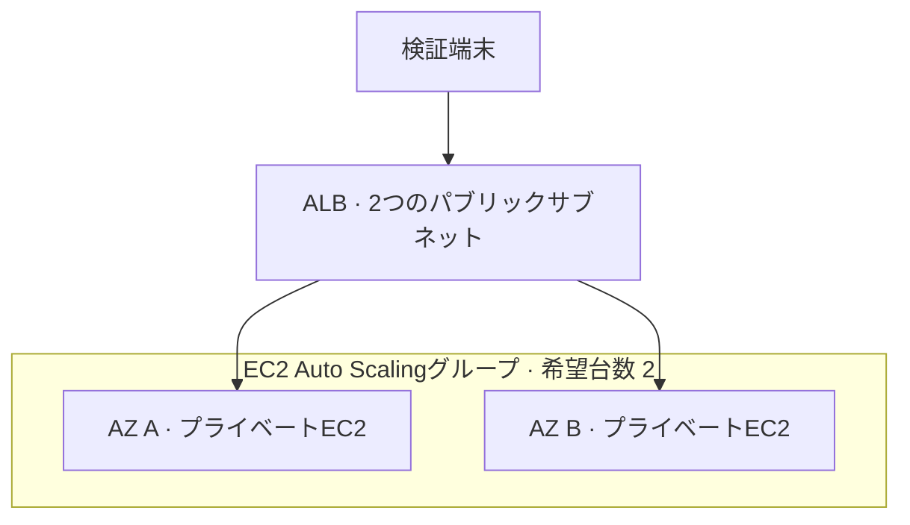

# EC2上のWebサービスの可用性向上

**進捗**：設計済み・構築前

## 背景と目的

社内のお知らせを掲載するWebサイトが、単一のEC2インスタンスで稼働している状況を想定します。このインスタンスが停止すると、利用者はサイトにアクセスできなくなります。

Webサーバーを2つのアベイラビリティーゾーン（AZ）に分散し、1台を停止しても残りのサーバーでリクエストを処理できるか、停止したインスタンスが自動で置き換わるかを検証します。

## 構成

| 項目 | 改善前 | 改善後 |
| --- | --- | --- |
| ネットワーク | 単一VPC、1つのAZのパブリックサブネット | 同じVPCの2つのAZにパブリック・プライベートサブネットを1つずつ配置 |
| アクセス経路 | 検証端末 → パブリックEC2 | 検証端末 → インターネット向けALB → プライベートEC2 |
| EC2 | 1台 | 2つのAZにまたがる1つのAuto Scalingグループ。希望するキャパシティは2台 |
| アクセス制御 | 検証端末のグローバルIPからのみHTTPを許可 | ALBは検証端末からのみHTTPを許可。EC2はALBのセキュリティグループからのみHTTPを許可 |

改善前後で同じWebページを配信します。`/` は検証端末からのアクセス確認に使い、応答ヘッダーにサーバーの識別子を付けます。`/health` はALBのヘルスチェックに使い、正常時はHTTP 200を返します。

## 構築・検証手順

- [ ] パブリックサブネットにEC2を1台構築し、`/` と `/health` の応答を確認する。
- [ ] 検証端末から `/` に約1秒間隔でリクエストを送り、EC2を1台停止する。時刻、HTTPステータスまたは接続エラー、応答したサーバーを記録する。
- [ ] ALB、ターゲットグループ、起動テンプレート、Auto Scalingグループを構築する。両方のAZに正常なターゲットが1台ずつあることを確認する。
- [ ] 改善後のALBに同じ方法でリクエストを送り、EC2を1台停止する。停止直後の失敗も含めて記録し、残りのEC2から応答があることを確認する。
- [ ] Auto Scalingのアクティビティ履歴で代替インスタンスの起動を確認する。EC2の停止操作から、新しいターゲットが `Healthy` になるまでの時間を計測する。

## 記録する結果

| 測定項目 | 改善前 | 改善後 |
| --- | --- | --- |
| 停止操作後、同じ観測時間内の失敗リクエスト数 / 総リクエスト数 | 未計測 | 未計測 |
| 停止後に応答したサーバー | 未確認 | 未確認 |
| 代替インスタンスが `Healthy` になるまでの時間 | — | 未計測 |

リクエストログ、ターゲットの状態、Auto Scalingのアクティビティ履歴を記録します。今回の検証対象はEC2インスタンス1台の停止です。
