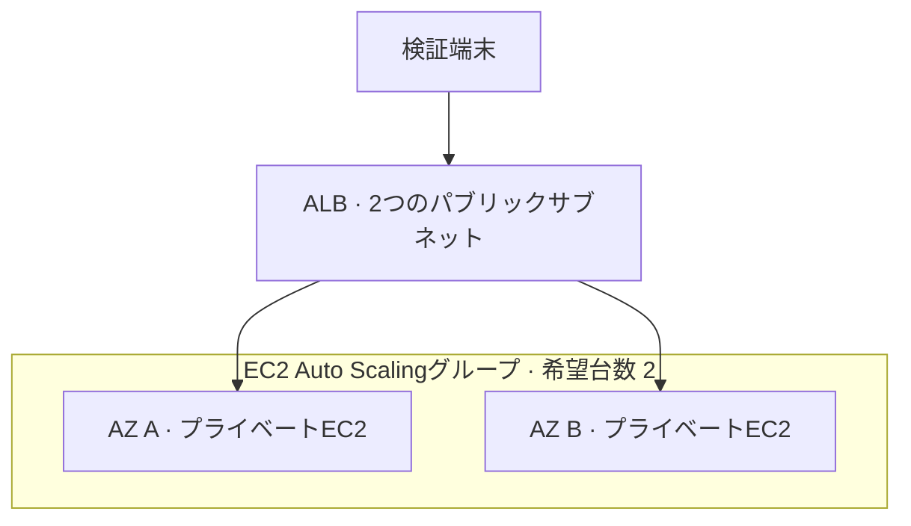

# EC2上のWebサービスの可用性向上

**進捗**：構築・検証完了

[検証レポート（測定結果・スクリーンショット）](./VERIFICATION.md)

## 背景と目的

社内のお知らせを掲載するWebサイトが、単一のEC2インスタンスで稼働している状況を想定します。このインスタンスが停止すると、利用者はサイトにアクセスできなくなります。

Webサーバーを2つのアベイラビリティーゾーン（AZ）に分散し、1台を停止しても残りのサーバーでリクエストを処理できるか、停止したインスタンスが自動で置き換わるかを検証します。

## 構成

| 項目 | 改善前 | 改善後 |
| --- | --- | --- |
| ネットワーク | 単一VPC、1つのAZのパブリックサブネット | 同じVPCの2つのAZにパブリック・プライベートサブネットを1つずつ配置 |
| アクセス経路 | 検証端末 → パブリックEC2 | 検証端末 → インターネット向けALB → プライベートEC2 |
| EC2 | 1台 | 2つのAZにまたがる1つのAuto Scalingグループ。希望するキャパシティは2台 |
| アクセス制御 | 検証端末のグローバルIPからのみHTTPを許可 | ALBは検証端末からのみHTTPを許可。EC2はALBのセキュリティグループからのみHTTPを許可 |

改善前後で同じWebページを配信しました。`/` は検証端末からのアクセス確認に、`/health` はALBのヘルスチェックに使用しました。

## 検証結果

最初の失敗を記録してから60秒間のHTTPリクエストを比較しました。

| 構成 | 成功 | 失敗 |
| --- | ---: | ---: |
| 単一EC2 | 0 / 29件 | 29件 |
| ALB・Auto Scaling | 30 / 45件 | 15件 |

改善後は、EC2を1台停止してもALB経由で一部のリクエストに応答できました。切り替え中には失敗が発生しましたが、その後はHTTP 200が続き、Auto Scalingによる代替EC2の起動後に正常なターゲットが2台に戻りました。検証対象はEC2インスタンス1台の手動停止です。

検証手順、復旧の時系列、コンソール画面は[検証レポート](./VERIFICATION.md)に掲載しています。
