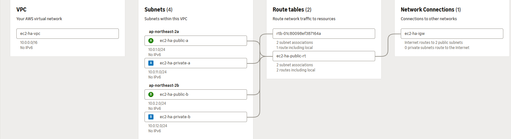
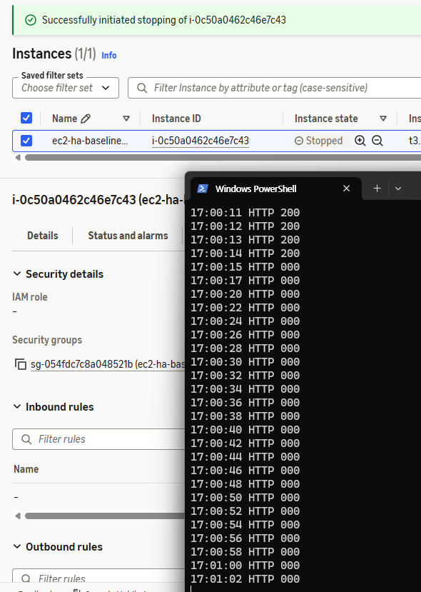
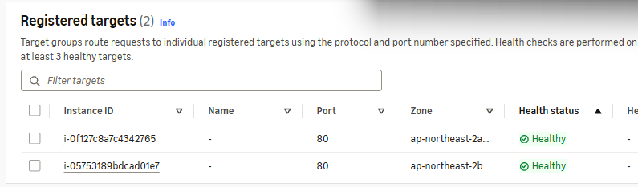
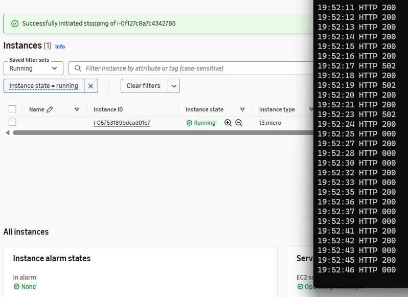
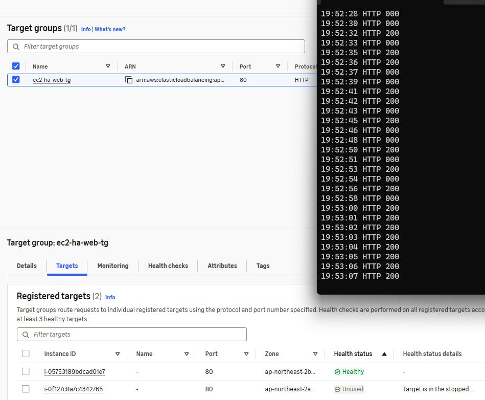
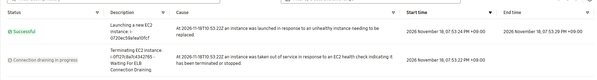
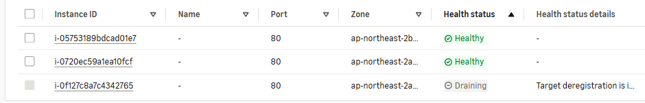

# EC2停止時の可用性検証

2026年11月18日、ソウルリージョン（`ap-northeast-2`）で、社内お知らせページを配信するEC2を1台停止し、単一EC2構成とALB・Auto Scaling構成の応答を比較しました。構成と設計時の検証計画は[プロジェクト概要](./README.md)に記載しています。

## 検証方法

単一EC2構成ではEC2の公開アドレスに、改善後はALBのDNS名に対して、PowerShellから `curl.exe` で `/` を繰り返し取得しました。リクエストごとに開始時刻とステータスを記録し、正常応答を確認した後、EC2をコンソールから1台停止しました。リクエストのタイムアウトは1秒で、完了後に1秒待って次のリクエストを送りました。

改善後は、ALBのターゲットグループに2つのAZのプライベートEC2を登録し、`/health` をヘルスチェックに使用しました。Auto Scalingグループの最小・希望・最大キャパシティはすべて2台です。検証では `ap-northeast-2a` のEC2を停止しました。

構築構成の確認

パブリックサブネット2つにはインターネットゲートウェイへの経路があり、プライベートサブネット2つにはインターネットへの経路がありません。

## HTTP応答の比較

最初の失敗を記録した時刻から60秒間を集計しました。終了時刻は集計に含めていません。時刻はすべてKSTです。

| 構成 | 観測区間 | 総リクエスト | HTTP 200 | HTTP 502 | curl 000 |
| --- | --- | ---: | ---: | ---: | ---: |
| 単一EC2 | 17:00:15〜17:01:15 | 29 | 0 | 0 | 29 |
| ALB・Auto Scaling | 19:52:17〜19:53:17 | 45 | 30 | 3 | 12 |

単一EC2構成では最初の失敗以降、ログの終了まで成功応答がありませんでした。改善後は、同じALBアドレスで試験を続けると成功応答が得られました。切り替わる間には計15件の失敗も記録しました。

`000` はcurlがHTTPステータスを取得できなかったことを示します。ログにはcurlの終了コードやエラーメッセージがないため、個々の失敗原因は特定できません。リクエストの所要時間によって、60秒間の総リクエスト数は変わります。

### 停止前後の記録

単一EC2では、インスタンスの停止後、17:00:15から `000` が続きました。

改善後の再試験を始める前に、2aと2bのターゲットがそれぞれ `Healthy` であることを確認しました。

2aのEC2を停止した直後は、ALB経由のHTTP 200と、HTTP 502およびcurlの `000` が混在しました。

## 改善後の復旧経過

| 時刻（KST） | 観測内容 |
| --- | --- |
| 19:52:17 | 最初のHTTP 502を記録。19:52:58までの29件のうち14件が成功。 |
| 19:53:00 | HTTP 200の連続応答を確認。ログの終了時刻19:56:00まで171件がすべて成功。 |
| 19:53:22 | Auto Scalingのアクティビティ履歴に、EC2ヘルスチェックを根拠に既存インスタンスをサービスから除外した記録が残った。 |
| 19:53:24〜19:53:29 | アクティビティ履歴に代替EC2の起動処理が記録された。 |
| 19:54台 | ターゲットグループで既存の2bと新規の2aがともに `Healthy`。停止した旧ターゲットは `Draining`。 |

停止した2aが `Unused`、既存の2bが `Healthy` と表示された時点で、ALB経由でHTTP 200が連続していました。

Auto Scalingのアクティビティ履歴には、停止したEC2の終了処理と代替EC2の起動成功が記録されています。撮影時点では、旧EC2の接続ドレイニングが進行中です。

19:54台のターゲット一覧では、既存の2bと新規の2aが `Healthy` になり、旧2aは登録解除中の `Draining` と表示されました。

## 確認できた範囲

正常なターゲットが2台に戻る前に、ALB経由の連続成功を観測しました。その後、Auto Scalingによる代替EC2の起動と2台の `Healthy` を確認しました。測定対象はEC2の手動停止1件です。停止ボタンを押した時刻、新しいターゲットが `Healthy` に遷移した正確な時刻、各リクエストに応答したインスタンスIDは取得していません。

集計には `baseline-stop.log` と `ha-stop-retest.log` を使用しました。復旧経過はターゲットグループとAuto Scalingのアクティビティ履歴のキャプチャで確認しました。
