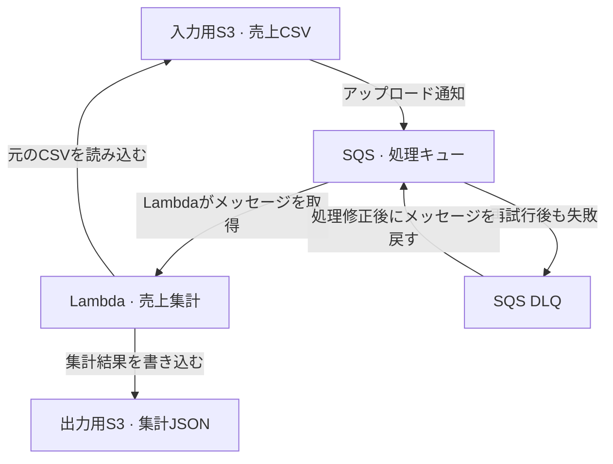

# 店舗別売上CSVの集計・再処理

**進捗**：構築・検証完了

## 背景と目的

各店舗が営業終了後に売上CSVを提出し、本部が店舗ごとの日次売上を集計する運用を想定します。ある店舗が従来と異なる日付形式でファイルを提出した場合、そのファイルの処理は失敗します。

正常なファイルの集計を続けながら、失敗したファイルと原因を特定し、処理を修正した後に元のCSVを再アップロードせずに集計できるかを検証します。

## 構成

SQSにはファイルの場所を含むイベント通知を格納し、LambdaがS3からCSVを読み込みます。ログには入力ファイルのキーと処理結果を記録します。検証ではLambdaが1回に受け取るメッセージを1件にし、ファイルごとの成功と失敗を追いやすくします。入力ファイルごとに固定の出力キーを使い、同じイベントを再処理しても集計ファイルが増えないようにします。

## テストデータ

| 店舗 | 日付形式 | 売上明細 | 検証結果 |
| --- | --- | --- | --- |
| A店 | `2026-11-17` | 120円、380円 | 初回処理で500円 |
| B店 | `2026/11/17` | 200円、450円 | 初回処理では失敗。修正後の再処理で650円 |

## 検証レポート

[正常処理、DLQへの移動、修正後の再処理](./VERIFICATION.md)をスクリーンショットとともに記録しました。検証には架空の売上データを使用しました。
