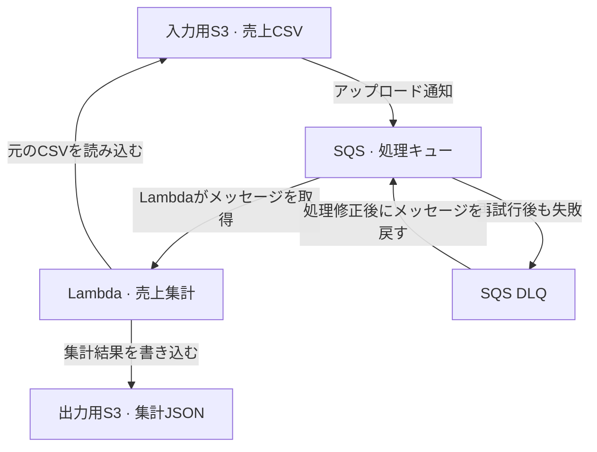

# 店舗別売上CSVの集計・再処理

**進捗**：設計済み・構築前

## 背景と目的

各店舗が営業終了後に売上CSVを提出し、本部が店舗ごとの日次売上を集計する運用を想定します。ある店舗が従来と異なる日付形式でファイルを提出した場合、そのファイルの処理は失敗します。

正常なファイルの集計を続けながら、失敗したファイルと原因を特定し、処理を修正した後に元のCSVを再アップロードせずに集計できるかを検証します。

## 構成

SQSにはファイルの場所を含むイベント通知を格納し、LambdaがS3からCSVを読み込みます。ログには入力ファイルのキーと処理結果を記録します。検証ではLambdaが1回に受け取るメッセージを1件にし、ファイルごとの成功と失敗を追いやすくします。入力ファイルごとに固定の出力キーを使い、同じイベントを再処理しても集計ファイルが増えないようにします。

## テストデータ

| 店舗 | 日付形式 | 売上明細 | 期待する結果 |
| --- | --- | --- | --- |
| A店 | `2026-11-17` | 120円、380円 | 初回処理で500円 |
| B店 | `2026/11/17` | 200円、450円 | 初回処理では失敗。修正後の再処理で650円 |

## 構築・検証手順

- [ ] 入出力用のS3バケット、SQSの処理キューとDLQ、Lambdaを作成する。
- [ ] 初期バージョンでは `YYYY-MM-DD` のみを受け付けるようにし、A店とB店のCSVをアップロードする。
- [ ] A店の集計結果が500円であることを確認する。B店のエラーをCloudWatch Logsで確認し、再試行後にB店のメッセージがDLQへ移動することを確認する。
- [ ] `YYYY/MM/DD` も読み込めるようLambdaを修正し、DLQのメッセージを元の処理キューに戻す。
- [ ] B店のCSVを再アップロードせず、出力用S3に650円の集計結果が保存されることを確認する。

## 記録する結果

- A店の正常処理と集計結果
- B店の入力ファイルのキーと日付の読み取りエラー
- DLQへの移動と、元のキューに戻した後の集計結果

検証には架空の売上データを使用します。
