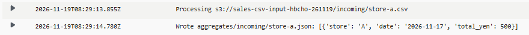
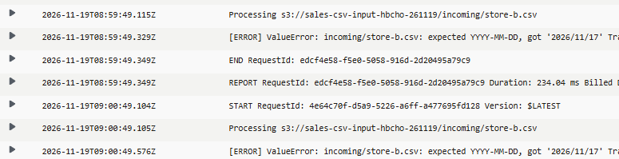
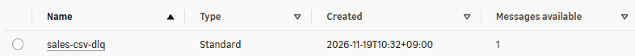
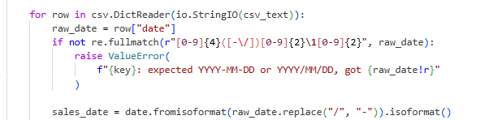
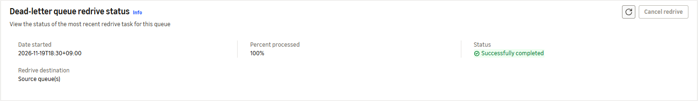
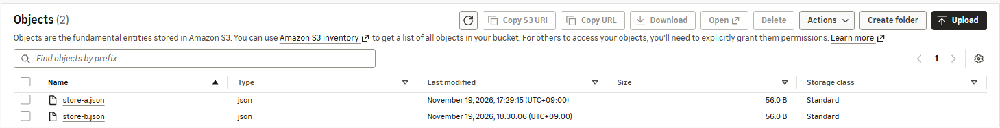
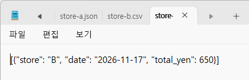

# 店舗別売上CSVの集計・再処理の検証

2026年11月19日、ソウルリージョン（`ap-northeast-2`）で検証しました。

| ケース | 入力 | 結果 |
| --- | --- | --- |
| A店の正常処理 | `2026-11-17`、120円と380円 | 初回処理で500円を出力 |
| B店の失敗と復旧 | `2026/11/17`、200円と450円 | 日付の検証に失敗しDLQへ移動。修正後の再処理で650円を出力 |

## 実装

入力用S3バケットの `incoming/` 配下にある `.csv` の作成通知を、Standardキュー `sales-csv-processing` に送信しました。Lambda（Python 3.13）は通知からS3オブジェクトキーを取得し、CSVを読み込んで、ファイル内の売上を店舗・日付ごとに合計します。出力は別のS3バケットの `aggregates/incoming/` に保存します。

処理キューには `sales-csv-dlq` を設定し、LambdaのSQSバッチサイズは1にしました。キューのアクセスポリシーで入力S3からの通知を許可し、Lambdaの実行ロールには処理キューの読み取りと入力・出力オブジェクトに必要な権限を付与しました。

## 1. A店の正常処理

`incoming/store-a.csv` をアップロードし、CloudWatch Logsで `store-a.json` の書き込みと合計500円を確認しました。



## 2. B店の処理エラーとDLQへの移動

初期実装は `YYYY-MM-DD` を受け付けるため、`incoming/store-b.csv` の `2026/11/17` は `ValueError` になりました。CloudWatch Logsでは再試行でも同じエラーが記録されました。



再試行後、SQSコンソールで `sales-csv-dlq` にメッセージが1件あることを確認しました。



## 3. 日付の処理を修正して再処理

Lambdaを修正し、`YYYY-MM-DD` と `YYYY/MM/DD` の両方を受け付けるようにしました。区切り文字が混在する入力を弾き、`date.fromisoformat` で実在する日付を検証し、集計に使う日付を `YYYY-MM-DD` に統一します。



修正版をデプロイした後、SQSのDLQ redriveで通知を元の処理キューに戻しました。SQSコンソールで `100%` と `Successfully completed` を確認しました。



## 4. 再処理の結果

B店のCSVは再アップロードせず、出力バケットに `aggregates/incoming/store-b.json` が生成されました。日付が `2026-11-17` に正規化され、合計が650円であることをJSONで確認しました。





```json
[{"store": "B", "date": "2026-11-17", "total_yen": 650}]
```
